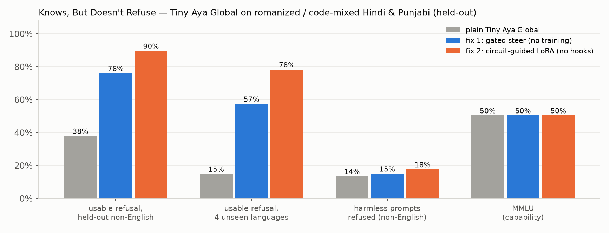

# Knows, But Doesn't Refuse

**Where — causally and at circuit level — Tiny Aya's safety breaks in romanized Hindi & Punjabi, and two fixes: a gated steer and a circuit-guided LoRA.**
Lexsi Labs × Cohere hackathon · Track 2b (locating safety, steering, circuit-level analysis, repair in the weights) · Track 2a (multilingual / code-mixed safety, adversarial evaluation with over-refusal).



Tiny Aya Global refuses 74% of held-out harmful English requests but only 26% in romanized Hindi and 15% in romanized Punjabi (usable refusals). An English-trained harm probe still separates harmful from harmless romanized prompts, so the model *knows*; what is missing is the refusal-direction component. Adding exactly the component the English twin has (and nothing else) restores refusal (52% → 76%), and CircuitKIT shows the refusal circuit's overlap with English falling from 0.60 (Devanagari) to 0.48 (Hinglish) to 0.21 (romanized Punjabi).

| Held-out, non-English | Plain | **Fix 1: gated steer** (no training) | **Fix 2: circuit-guided LoRA** (no hooks) |
|---|---|---|---|
| Usable refusal on harmful prompts | 38% | 76% | **90%** |
| Four romanized languages never seen in training | 15% | 57% | **78%** |
| Jailbreak wrappers (fiction framing) | 35% (30%) | 70% (30%) | **75% (77%)** |
| Harmless prompts refused | 13.5% | 15.1% | 17.7% |
| MMLU (AuditKIT) | 50.5% | 50.5% | **50.5%** |

Full write-up: [`docs/hf-article-v4.md`](docs/hf-article-v4.md) (Day-4 notes: [`docs/day4_findings.md`](docs/day4_findings.md)). The v1.0 submission is tagged `v1.0-submission` ([`FROZEN.md`](FROZEN.md)).

## Use the fixes

```python
# Fix 2: LoRA (no hooks)
from peft import PeftModel
model = PeftModel.from_pretrained(model, "sunit12/tiny-aya-global-codemix-refusal-lora").merge_and_unload()
```
```bash
# Fix 2 in llama.cpp / Ollama-style runtimes, on CPU
llama-cli -m tiny-aya-global-q4_k_m.gguf --lora codemix-refusal-lora-f16.gguf
```
Fix 1 (gated steer): `guard.py` from [`sunit12/tiny-aya-global-codemix-refusal-guard`](https://huggingface.co/sunit12/tiny-aya-global-codemix-refusal-guard). Demo (base vs LoRA side by side, llama.cpp, CPU): `space_demo/` → `docker build -t kbdr space_demo && docker run -p 7860:7860 kbdr`.

## Layout

| Path | What |
|---|---|
| `job_baseline.py`, `job_judge4.py`, `analyze.py`, `job_langid.py` | generations + hidden states; Aya Expanse 8B 4-way judge; knows-vs-acts and language-ID analyses |
| `gate_v3*.py`, `job_steer2.py`, `job_cast.py`, `job_capability.py` | fix 1 (gate + steer), SafeTune CAST baseline, AuditKIT MMLU (`ADAPTER=` for LoRAs) |
| `job_causal.py`, `job_causal2.py`, `job_ablate_all.py` | causal patching (last token / all positions, twin-sized) and all-layer directional ablation |
| `job_circuit.py`, `job_heads.py`, `data/minimal_pairs/` | CircuitKIT refusal circuits per script; head ablation / amplification |
| `job_distill_data.py`, `build_distill_sft*.py`, `job_wrap_data.py`, `job_retain_data.py`, `job_distill_train.py` | fix 2: AlignTune distillation into a LoRA (`LORA_LAYERS=10-20`) + evaluation |
| `job_eval_adapter.py`, `job_gguf_lora.py`, `kaggle_run.py` | evaluate any adapter; GGUF conversion; free-GPU (Kaggle) runner |
| `response_lid.py`, `compare_final.py`, `bootstrap_ci.py`, `analyze_day4.py`, `fig_day4.py` | reply language-ID, final tables, paired cluster-bootstrap CIs, figures |
| `auditkit_codemix/` | AuditKIT scenario + multilingual refusal scorers |
| `data/` | benchmark, India-specific pairs, perturbation / filler / transliteration / unseen-language / jailbreak sets |
| `results/`, `runs/` | every table, JSON and figure; generations + judge labels (hidden states in the HF logs repo) |
| `publish/`, `space_demo/` | what is pushed to the HF repos; llama.cpp demo |

Every script declares its dependencies inline (PEP 723): `hf jobs uv run --flavor a10g-small --secrets HF_TOKEN job_x.py …` or `uv run x.py`.

## Hugging Face

- Benchmark (+ unseen-language, jailbreak and minimal-pair sets): [`sunit12/codemix-safety-bench`](https://huggingface.co/datasets/sunit12/codemix-safety-bench)
- Logs (all generations, labels, hidden states, code, article): [`sunit12/codemix-safety-logs`](https://huggingface.co/datasets/sunit12/codemix-safety-logs)
- Fix 1: [`sunit12/tiny-aya-global-codemix-refusal-guard`](https://huggingface.co/sunit12/tiny-aya-global-codemix-refusal-guard), [`sunit12/tiny-aya-fire-codemix-refusal-guard`](https://huggingface.co/sunit12/tiny-aya-fire-codemix-refusal-guard)
- Fix 2: [`sunit12/tiny-aya-global-codemix-refusal-lora`](https://huggingface.co/sunit12/tiny-aya-global-codemix-refusal-lora) (+ GGUF adapter); distillation data [`sunit12/codemix-refusal-distill-v2`](https://huggingface.co/datasets/sunit12/codemix-refusal-distill-v2)
- Explorer: https://sunit12-knows-but-doesnt-refuse-explorer.static.hf.space
